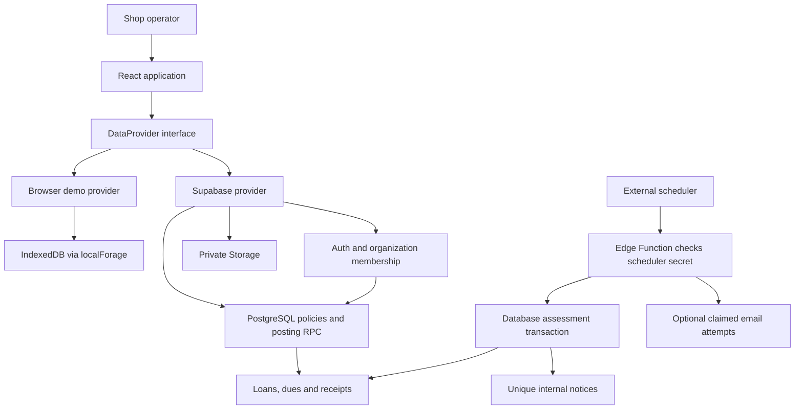

# PawnTrack — Loan & Collateral Management System

PawnTrack connects a borrower's record, pledged items, principal balance, monthly interest dues and receipts. A shop operator can open a loan, record a collection, see what remains overdue, and export the register to CSV or PDF. The dashboard refreshes from provider queries after changes.

A shop that keeps pledges, cash collections and due dates in separate spreadsheets has to reconcile them by hand. PawnTrack is a personal full-stack engineering project that brings those records together. The default browser demo uses synthetic borrowers.

## Follow one loan

A borrower pledges an item for **₹1,00,000** at **2% monthly simple interest**. Origination creates the loan and its first ₹2,000 interest invoice together. A ₹10,000 principal receipt brings the balance to **₹90,000**. The issued ₹2,000 invoice keeps its face value. At the next unbilled monthly assessment, ₹90,000 at 2% produces **₹1,800**. Paying ₹1 toward that first invoice leaves ₹1,999 outstanding. [Posting rules](docs/architecture/FINANCIAL_RULES.md) · [Database tests](tests/integration/ledger.test.mjs)

## Architecture



| Capability | Browser demo | Supabase |
|---|---|---|
| Identity | Built-in sample account | Supabase Auth and a profile-bound organization |
| Records and media | Local browser storage | PostgreSQL and private Storage buckets |
| Tenant boundary | One synthetic shop | RLS, scoped RPCs and composite foreign keys |
| Collections | One local ledger snapshot per posting | Row lock, exact numeric arithmetic and transaction rollback |
| Connectivity | A loaded demo supports local changes offline | Shop records and mutations require connectivity |
| Recurring dues | Calculated locally on dashboard refresh and posting | Authorized scheduler and payment-time catch-up |

## Getting started

Use Node **24.14.0** and npm. From a fresh checkout:

```sh
npm ci
npm run dev
```

Open the Vite URL and choose **Use Demo Account**. The sample login is `demo@pawntrack.app` / `demo123`. **Reset Demo** restores this browser's sample data. Use synthetic data in this mode.

For the Supabase mode, install Docker and Supabase CLI **2.104.0**, then run:

```sh
supabase start
supabase db reset --local
supabase status
```

The reset command rebuilds this checkout's disposable local database. Copy `.env.example` to `.env.local`, set `VITE_DATA_MODE=supabase`, `VITE_SUPABASE_URL=http://127.0.0.1:56421`, and set `VITE_SUPABASE_ANON_KEY` to the local **publishable or anon** key. Restart Vite and sign up. If email confirmation is enabled, confirm the address before signing in. An existing installation needs the [staged upgrade procedure](docs/architecture/DATABASE_MODEL.md).

```sh
npm run typecheck
npm run lint
npm test
npx playwright install chromium
npm run test:e2e
npm run build
npm run preview
```

The full-stack verifier installs dependencies, rebuilds the local database and exercises Auth, the API, Storage and the Deno entrypoint. Use a disposable checkout with the supplied local project ID and ports. [Verification instructions](docs/verification/TEST_VERIFICATION.md)

## Security and financial behavior

The first authenticated session provisions an organization or returns the existing membership. Browser users can manage customer and collateral details in that organization. Database permissions reserve receipt posting and schedule updates for their respective functions. Composite foreign keys keep each child record in its parent's organization. Private file access checks the parent folder and issues a short-lived signed URL. [Database model](docs/architecture/DATABASE_MODEL.md) · [Two-organization API tests](tests/integration/tenants.test.mjs)

A payment locks its loan, assesses missing periods, validates the amount, updates the balance or allocates interest oldest first, and records one receipt. The transaction rolls back on failure. A retry with the same request ID returns the original receipt. Full closure requires zero principal and settlement of issued dues. [Ledger implementation](supabase/migrations/20261119000200_ledger.sql) · [Financial verification](tests/integration/ledger.test.mjs)

The scheduler uses its own server-side secret. Due creation, schedule advancement and internal notices commit together. Optional email has a separate claim and attempt state. Deploying the function and scheduling invocations are separate operator steps. [Scheduler setup and recovery](docs/project-guide/HOW_IT_WORKS.md)

## Verification and limits

The local verification inventory comprises **30 Vitest cases**, **12 local Supabase integration cases** and **4 Chromium workflows** (including an authenticated two-shop browser session). The fresh-install and legacy-upgrade checks are separate commands. Each CI run publishes its SHA, durations, exit codes and JUnit evidence. [Workflow runs](https://github.com/vedpatel-real-ai/pawnstone-vault/actions/workflows/verify.yml) · [Verification report](docs/verification/TEST_VERIFICATION.md) · [Claim matrix](docs/verification/CLAIM_MATRIX.md)

Verification uses synthetic identities and disposable services. Hosted project grants, live scheduling, real email delivery, business-specific lending rules and reconciliation of historical cash collections need separate operational evidence. A signed file URL is usable until expiry by anyone who has it. The demo stores records on the device, and anyone with access to that browser profile can use the sample account.

## Common questions

**Where should I start?** Open the demo, choose a borrower on the Customers page, then originate a loan with a description of the pledged item. The loan appears in the portfolio and the collateral register.

**What does the dashboard call earnings?** The monthly interest chart sums interest receipts by payment date. A principal repayment reduces the money outstanding and appears separately in the ledger.

**Can a borrower pay part of an invoice?** Yes. A ₹20 invoice with ₹1 collected still has ₹19 outstanding. Its pending or overdue status remains until the full amount has been allocated.

**What if two operators post at once?** PostgreSQL serializes collections on the same loan. Both receipts can commit, and the second transaction calculates from the balance left by the first.

**How do retries work?** The collection form keeps an opaque request ID for an unacknowledged set of terms in the tab. The database recognizes that ID within the organization. A genuinely new collection needs a new ID.

**Who can see a borrower's documents?** Authorized shop users can request signed URLs for objects in that borrower's folder. The client displays a placeholder if signing fails.

**What happens at month end?** A January 31 loan uses February 28 or 29, then March 31. The accounting day follows Asia/Kolkata.

**Can I enter a payment offline?** The browser demo can record sample collections locally. The Supabase mode requires a connection and does not replay financial submissions when the device reconnects.

**Does an email attempt mean the borrower received a reminder?** The optional mail worker records a provider response. Delivery to the borrower's inbox requires separate provider evidence.

[Detailed technical FAQ](docs/project-guide/TECHNICAL_FAQ.md) · [How it works](docs/project-guide/HOW_IT_WORKS.md)
